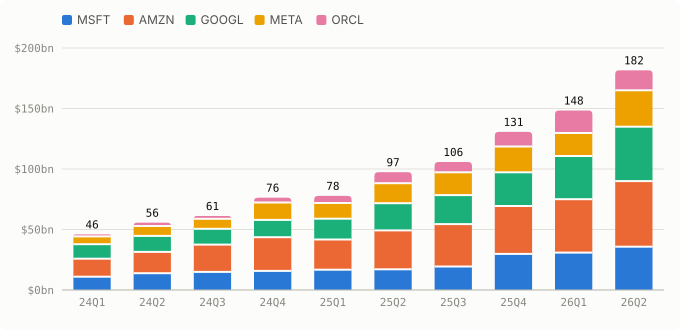
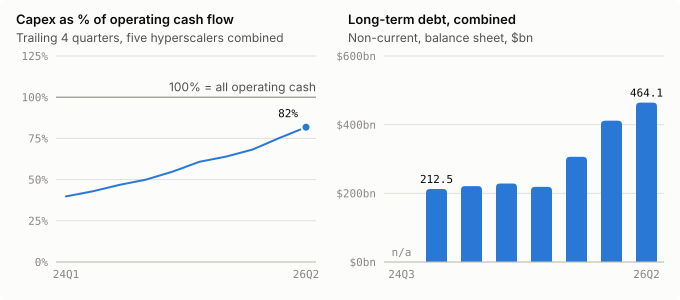
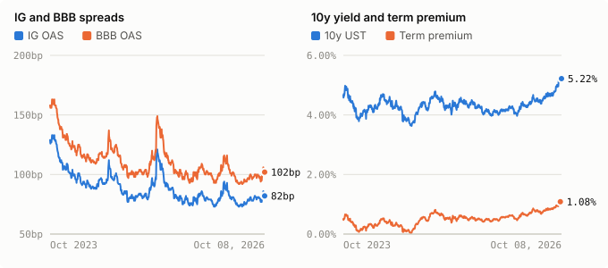
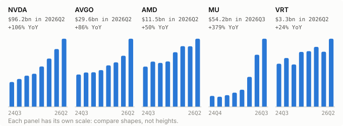
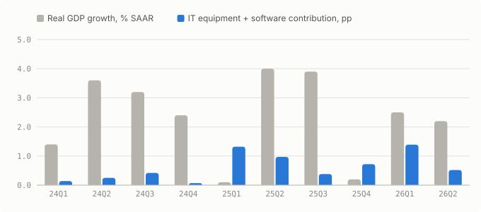
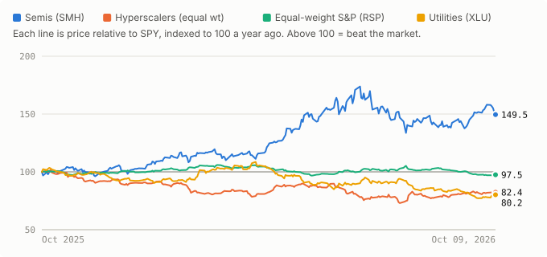

# Memory and TSMC still booming; OpenAI revenue shortfall hits Oracle and CoreWeave

*AI build-out brief · 2026-10-09*

The build-out is on track, with this window's strongest supplier numbers yet from Micron, TSMC and Samsung. What changed is on the demand and funding side: a reported OpenAI revenue shortfall hit the names that depend on it, and Oracle is reported to be moving chip financing off its balance sheet. IG spreads did not react (0.82%), and the Fed minutes kept rates as the funding pressure.

**What changed this week**

- Micron's fiscal Q4 (June–August) revenue was $54.23bn against $11.32bn a year earlier, and it guided fiscal Q1 to $61.5bn ± $1.5bn, so memory is still guiding up quarter on quarter.
- TSMC's September revenue was NT$511.86bn, +54.6% YoY, and Samsung's preliminary Q3 operating profit was 107.4 trillion won, +782.5% YoY.
- Oracle is reported to be in talks with Apollo and Goldman Sachs on a separate company that would buy AI chips and lease them to Oracle, keeping the borrowing off its balance sheet.
- News reports of OpenAI revenue about $20bn below prior estimates hit the exposed names on October 8: Oracle fell about 5%, and CoreWeave is -8.4% on the week.
- The minutes of the September 15–16 FOMC, which raised rates to 3-3/4 to 4 percent, say most participants see another hike as likely appropriate by year end and note that hyperscaler spreads remained wide.

## 1. Spend (no change)

**Capex is still accelerating; no spender changed guidance in the window.**

Unchanged: no capex guidance changes from the five in the window. Combined capex was $181.5bn in 2026Q2, +86.5% YoY, and the next read is the October earnings round.

## 2. Funding (new this week)

**The marginal dollar is moving off balance sheet at the weakest spender, while index spreads stay calm.**

Oracle is reported (WSJ, via Yahoo Finance) to be negotiating with Apollo and Goldman Sachs over a separate company that would buy chips and lease them to Oracle. Its fiscal Q1 (June–August) capex was $28.5bn against $23.1bn of operating cash flow. The Fed minutes say hyperscaler spreads 'remained wide'. Index spreads are calm: IG 0.82%, BBB 1.02%, both -4bp on the week. HY is 3.15%, +48bp on the month. The 10y is 5.22%. The term premium is 1.08%, +19bp on the month.

- [WSJ report: Oracle in talks with Apollo and Goldman on an off-balance-sheet chip-leasing vehicle; June–August capex $28.5bn](https://finance.yahoo.com/technology/article/oracle-stock-falls-on-more-debt-to-fund-ai-chip-buying-openai-revenue-disclosure-181653494.html)
- [FOMC minutes, September 15–16: hike to 3-3/4 to 4 percent; hyperscaler spreads 'remained wide'](https://www.federalreserve.gov/monetarypolicy/fomcminutes20260916.htm)

## 3. Receivers (new this week)

**Suppliers are booking more than ever, and memory is guiding higher.**

Micron's fiscal Q4 (June–August) revenue was $54.23bn, up from $41.46bn the prior quarter, at an 86.8% GAAP gross margin. It guided fiscal Q1 (September–November) to $61.5bn ± $1.5bn, the opposite of the T5 trigger. TSMC's September sales were NT$511.86bn, +54.6% YoY but -0.6% from August. Samsung's preliminary Q3 operating profit was 107.4 trillion won, +782.5% YoY, on revenue of 195 trillion won. NVDA is still +105.9% YoY in 2026Q2.

- [Micron fiscal Q4 2026 results and fiscal Q1 2027 guidance (8-K, September 30)](https://www.sec.gov/Archives/edgar/data/0000723125/000072312526000018/a2026q4ex991-pressrelease.htm)
- [TSMC September 2026 revenue (6-K, October 8)](https://www.sec.gov/Archives/edgar/data/0001046179/000104617926000680/tsm-revenue20261008.htm)
- [Samsung preliminary Q3 2026 operating profit and revenue (news report)](https://www.koreaherald.com/article/10896336)

## 4. Macro (new this week)

**The Fed now treats the build-out as a demand force to lean against, and power remains the physical constraint.**

The September minutes, released October 7, say 'the scale and pace of the AI buildout had continued to surprise to the upside'. Most participants see another hike by year end. The Fed expects AI to lift productivity later. For now productivity is +2.2%, down from +2.9%. IT equipment plus software are 0.75pp of 2.20% average growth, or 34%. On power, New Mexico regulators rejected the pipeline route for Oracle's 2.45GW Project Jupiter, so Oracle may truck in gas (news report).

- [FOMC minutes: AI buildout surprising to the upside; most see another hike by year end](https://www.federalreserve.gov/monetarypolicy/fomcminutes20260916.htm)
- [Project Jupiter pipeline rejected; Oracle weighs trucked gas and sent a force majeure notice](https://www.tipranks.com/news/why-oracle-stock-orcl-is-sinking-today-october-8-2026)

## 5. Market (new this week)

**Equity investors priced counterparty risk this week: they sold the OpenAI-exposed names and suppliers, not the big spenders.**

News reports of OpenAI revenue about $20bn below prior estimates hit exposed names on October 8. Oracle fell about 5% that day. CoreWeave is -8.4% on the week and SMH -4.3%. The big spenders held up: AMZN +4.3%, MSFT +3.4%, META -1.3%. XLU rose 4.0%. Over the year the split stands: SMH/SPY 149.5 against 82.4 for the hyperscalers. Breadth narrowed, with RSP/SPY at 97.5 against 100.2 a month ago.

- [Oracle falls 5% on the OpenAI revenue report and the debt-financing report](https://finance.yahoo.com/technology/article/oracle-stock-falls-on-more-debt-to-fund-ai-chip-buying-openai-revenue-disclosure-181653494.html)
- [FT report of OpenAI revenue about $20bn below expectations; CoreWeave and Nasdaq fall (news report)](https://www.fxleaders.com/news/2026/10/08/crwv-stock-falls-10-as-openai-concerns-and-asian-chip-rout-spreads-to-nasdaq/)

## Tripwires

| ID | Tripwire | Status | Reading |
|---|---|---|---|
| T1 | Spend slows | ○ Clear | Combined capex +86.5% YoY in 2026Q2 (data/summary.md); no guidance cuts in the window. |
| T2 | Cash burn | ◐ Near | T4Q capex/OCF 82% in 2026Q2, up from 75% in 2026Q1, against a 100% line (data/summary.md). |
| T3 | IG spreads wake up | ○ Clear | IG OAS 0.82%, BBB OAS 1.02% on 2026-10-08, against 1.10% / 1.30% (FRED, data/summary.md). |
| T4 | Weak link cracks | ◐ Near | Oracle still BBB- at S&P with no rating action in the window; it sent a force majeure notice on Project Jupiter; no CoreWeave credit event found. |
| T5 | Suppliers roll over | ○ Clear | NVDA +105.9% YoY in 2026Q2 (data/summary.md); Micron guided fiscal Q1 to $61.5bn ± $1.5bn, up from $54.23bn (8-K). |
| T6 | Rates bite | ◐ Near | 10y 5.22% on 2026-10-08 against 5.50%; term premium 1.08% (2026-10-02), +19bp in a month, against 1.25% (FRED, data/summary.md). |
| T7 | Payoff shows up (bullish) | ○ Clear | Productivity +2.2% over four quarters (quarter starting 2026-04-01), down from +2.9% (data/summary.md). |

## Suggested edits to your thesis

- T4: add a customer-side trigger. This week's equity stress came from the end customer: news reports put OpenAI revenue about $20bn below prior estimates, and Oracle sent a force majeure notice on Project Jupiter. Suggested addition: 'a major AI-lab customer cuts or defers contracted capacity, or a spender invokes force majeure on a contracted data center.'
- Point 2 / T2: T2 measures only on-balance-sheet capex. Oracle's reported chip-leasing vehicle with Apollo and Goldman would keep that spend out of both capex and debt. Consider tracking off-balance-sheet lease commitments alongside the capex/OCF ratio.

## Sources

1. [Micron Technology Form 8-K, fiscal Q4 2026 press release](https://www.sec.gov/Archives/edgar/data/0000723125/000072312526000018/a2026q4ex991-pressrelease.htm)
2. [TSMC Form 6-K, September 2026 revenue report](https://www.sec.gov/Archives/edgar/data/0001046179/000104617926000680/tsm-revenue20261008.htm)
3. [Samsung Q3 2026 preliminary earnings (Korea Herald)](https://www.koreaherald.com/article/10896336)
4. [Minutes of the Federal Open Market Committee, September 15–16, 2026](https://www.federalreserve.gov/monetarypolicy/fomcminutes20260916.htm)
5. [Oracle stock falls on more debt to fund AI chip buying, OpenAI revenue disclosure (Yahoo Finance)](https://finance.yahoo.com/technology/article/oracle-stock-falls-on-more-debt-to-fund-ai-chip-buying-openai-revenue-disclosure-181653494.html)
6. [Why Oracle Stock (ORCL) Is Sinking Today, October 8, 2026 (TipRanks)](https://www.tipranks.com/news/why-oracle-stock-orcl-is-sinking-today-october-8-2026)
7. [CRWV Stock Falls 10% as OpenAI Concerns and Asian Chip Rout Spreads to Nasdaq (FX Leaders)](https://www.fxleaders.com/news/2026/10/08/crwv-stock-falls-10-as-openai-concerns-and-asian-chip-rout-spreads-to-nasdaq/)
